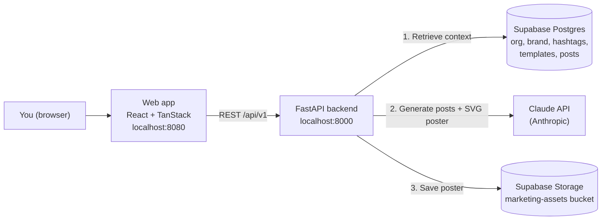

# BuildHer AI Labs — AI Social Media Manager

An AI agent that turns one event brief into ready-to-review social media content. It writes captions for Instagram, LinkedIn and X, picks hashtags and a call to action, and designs an SVG poster in your brand colours. Every post is saved as a draft for a person to approve.

It is built by [BuildHer AI Labs](https://github.com/BethMwangi) as a learning project for our community. Clone it, run it, break it, and make it your own.

---

## Contents

1. [How it works](#how-it-works)
2. [Tech stack](#tech-stack)
3. [Repository structure](#repository-structure)
4. [Prerequisites](#prerequisites)
5. [Step 1 — Clone the repo](#step-1--clone-the-repo)
6. [Step 2 — Set up Supabase (database and storage)](#step-2--set-up-supabase-database-and-storage)
7. [Step 3 — Get an Anthropic API key](#step-3--get-an-anthropic-api-key)
8. [Step 4 — Run the backend (FastAPI)](#step-4--run-the-backend-fastapi)
9. [Step 5 — Run the frontend (React)](#step-5--run-the-frontend-react)
10. [Step 6 — Test that everything works](#step-6--test-that-everything-works)
11. [Environment variables](#environment-variables)
12. [API reference](#api-reference)
13. [Troubleshooting](#troubleshooting)
14. [Known limitations](#known-limitations)
15. [Contributing](#contributing)

---

## How it works



When you generate a campaign, the backend:

1. **Retrieves context.** It loads your organisation's mission, purpose and audience, your brand colours, font and tone, your saved hashtags, and the poster template you picked. This step is the "retrieval" in retrieval-augmented generation (RAG).
2. **Writes the posts.** It sends that context and your brief to Claude, which returns captions, hashtags, a call to action and a poster brief in a fixed XML format.
3. **Designs the poster.** A second Claude call turns the poster brief and your brand colours into an SVG poster. The SVG is checked to be valid before it is saved to Supabase Storage.
4. **Saves a draft.** The post is saved as a draft. A person reviews it, can regenerate the poster, and approves it.

If no Anthropic key is set, or Claude returns an error, the app falls back to template-based text, so the screen is never empty.

---

## Tech stack

| Layer | Tools | Language |
|---|---|---|
| Frontend | React 19, TanStack Start / Router / Query, Tailwind CSS v4, shadcn/ui, Vite | TypeScript |
| Backend | FastAPI, Pydantic, Uvicorn | Python |
| Database and files | Supabase (Postgres + Storage) | SQL |
| AI | Anthropic Claude API (Messages API) | — |

---

## Repository structure

```text
social-media-agent/
├── apps/
│   ├── api/                      # FastAPI backend
│   │   ├── app/
│   │   │   ├── main.py           # App entry point, CORS, routers
│   │   │   ├── core/             # Settings (.env) and Supabase client
│   │   │   ├── routes/           # HTTP endpoints (one file per resource)
│   │   │   ├── services/         # Business logic, incl. ai_service.py (the agent)
│   │   │   ├── repositories/     # Supabase queries
│   │   │   └── schemas/          # Pydantic request/response models
│   │   └── requirements.txt
│   └── web/                      # React frontend
│       ├── src/
│       │   ├── routes/           # Pages: dashboard, ai-generator, assets, ...
│       │   ├── services/api.ts   # All calls to the backend
│       │   ├── hooks/            # React Query hooks
│       │   └── components/       # Layout and shadcn/ui components
│       └── package.json
├── scripts/run-api.sh            # Starts the backend from apps/api/.venv
├── docs/                         # (reserved)
├── n8n/                          # (reserved for publishing workflows)
└── docker-compose.yml            # (empty for now)
```

The backend is layered: **routes** handle HTTP, **services** hold the logic, **repositories** talk to Supabase.

---

## Prerequisites

Install these first:

| Tool | Version | Check with |
|---|---|---|
| Git | any recent | `git --version` |
| Python | 3.10 or newer (tested with 3.11) | `python3 --version` |
| Node.js | 22 (see `apps/web/.nvmrc`) | `node --version` |
| npm | comes with Node | `npm --version` |

You also need two free accounts:

- **Supabase**: [supabase.com](https://supabase.com), for the database and file storage.
- **Anthropic**: [console.anthropic.com](https://console.anthropic.com), for the Claude API. API usage is paid, but each campaign uses only two small requests.

---

## Step 1 — Clone the repo

```bash
git clone https://github.com/BethMwangi/social-media-agent.git
cd social-media-agent
```

---

## Step 2 — Set up Supabase (database and storage)

### 2.1 Create a project

1. Sign in at [supabase.com](https://supabase.com) and click **New project**.
2. Choose a name and a database password (save it somewhere safe), then pick the region closest to you.
3. Wait a minute or two for the project to be ready.

### 2.2 Copy your project URL and secret key

1. Open **Project Settings → API Keys** (or **Project Settings → API** on older dashboards).
2. Copy the **Project URL**. It looks like `https://abcdefghijkl.supabase.co`.
3. Copy the **secret key**: the `service_role` key, or a secret key starting with `sb_secret_`.

> **Keep the secret key private.** It can read and write everything in your database. It goes only in the backend `.env` file. Never put it in frontend code, commit it to Git, or share it in chat.

### 2.3 Create the tables

Open **SQL Editor → New query**, paste the SQL below and click **Run**. It is safe to run more than once.

<details>
<summary><b>Click to show the schema SQL</b></summary>

```sql
-- 1. Tables ---------------------------------------------------------------

create table if not exists public.organizations (
  id          uuid primary key default gen_random_uuid(),
  name        text not null,
  slug        text not null unique,
  mission     text,
  purpose     text,
  audience    text,
  email       text,
  created_at  timestamptz not null default now()
);

-- One row per organization. Do NOT add a unique constraint on organization_id:
-- the web app reads organization.brand_settings as a list.
create table if not exists public.brand_settings (
  id               uuid primary key default gen_random_uuid(),
  organization_id  uuid not null references public.organizations(id) on delete cascade,
  primary_color    text,
  secondary_color  text,
  accent_color     text,
  background_color text,
  text_color       text,
  font_family      text,
  logo_url         text,
  tone             text,
  created_at       timestamptz not null default now()
);

create table if not exists public.campaigns (
  id               uuid primary key default gen_random_uuid(),
  organization_id  uuid not null references public.organizations(id) on delete cascade,
  title            text not null,
  campaign_type    text,
  objective        text,
  status           text not null default 'draft',
  created_at       timestamptz not null default now()
);

create table if not exists public.events (
  id                uuid primary key default gen_random_uuid(),
  campaign_id       uuid references public.campaigns(id) on delete set null,
  title             text not null,
  description       text,
  event_type        text,
  status            text default 'draft',
  event_date        timestamptz not null,
  location          text,
  registration_url  text,
  image_url         text,
  created_at        timestamptz not null default now()
);

create table if not exists public.hashtags (
  id               uuid primary key default gen_random_uuid(),
  organization_id  uuid not null references public.organizations(id) on delete cascade,
  tag              text not null,
  created_at       timestamptz not null default now()
);

create table if not exists public.assets (
  id                  uuid primary key default gen_random_uuid(),
  organization_id     uuid references public.organizations(id) on delete cascade,
  campaign_id         uuid references public.campaigns(id) on delete set null,
  name                text,
  description         text,
  file_url            text not null,
  asset_type          text not null default 'image',
  platform            text,
  dimensions          text,
  uploaded_by         text,
  template_category   text,
  is_template         boolean not null default false,
  canva_template_url  text,
  created_at          timestamptz not null default now()
);

create table if not exists public.content_templates (
  id               uuid primary key default gen_random_uuid(),
  organization_id  uuid not null references public.organizations(id) on delete cascade,
  name             text not null,
  platform         text not null,
  template_type    text not null,
  prompt_template  text not null,
  created_at       timestamptz not null default now()
);

create table if not exists public.generated_posts (
  id               uuid primary key default gen_random_uuid(),
  campaign_id      uuid references public.campaigns(id) on delete set null,
  organization_id  uuid references public.organizations(id) on delete cascade,
  asset_id         uuid references public.assets(id) on delete set null,
  template_id      uuid references public.content_templates(id) on delete set null,
  file_url         text,
  platform         text not null,
  content          text not null,
  status           text not null default 'draft',
  generated_by     text,
  ai_model         text,
  approved_at      timestamptz,
  published_at     timestamptz,
  created_at       timestamptz not null default now()
);

-- 2. Security --------------------------------------------------------------
-- The API uses the secret (service role) key, which bypasses RLS.
-- Turning RLS on with no policies keeps the public anon key locked out.

alter table public.organizations     enable row level security;
alter table public.brand_settings    enable row level security;
alter table public.campaigns         enable row level security;
alter table public.events            enable row level security;
alter table public.hashtags          enable row level security;
alter table public.assets            enable row level security;
alter table public.content_templates enable row level security;
alter table public.generated_posts   enable row level security;

grant usage on schema public to service_role;
grant all on all tables in schema public to service_role;
```

</details>

### 2.4 Add the starter data

The web app looks up an organisation with the slug **`buildherai-labs`**, so this exact slug must exist. Run the SQL below **once** in a new SQL Editor query. You can change the text (mission, audience, tone, colours, hashtags) to describe your own community, but keep the slug.

<details>
<summary><b>Click to show the seed SQL</b></summary>

```sql
-- The web app looks up the organization with slug 'buildherai-labs'.
-- Keep that slug; change the other text to describe your own community.

with org as (
  insert into public.organizations (name, slug, mission, purpose, audience, email)
  values (
    'BuildHerAI Labs',
    'buildherai-labs',
    'Help women learn, build and launch with AI.',
    'Run hands-on workshops, hackathons and cohorts where women build real AI projects.',
    'Women in tech and women who are new to AI, students and early-career builders.',
    'hello@example.com'
  )
  returning id
),
brand as (
  insert into public.brand_settings
    (organization_id, primary_color, secondary_color, accent_color,
     background_color, text_color, font_family, tone)
  select id, '#7C3AED', '#1F1147', '#D946EF', '#F8F5FF', '#1F1147',
         'DM Sans', 'Warm, encouraging and practical. Plain language, no jargon.'
  from org
),
tags as (
  insert into public.hashtags (organization_id, tag)
  select id, t from org,
    unnest(array['BuildHerAI', 'WomenInAI', 'WomenInTech', 'AIWorkshop', 'LearnAI']) as t
),
campaign as (
  insert into public.campaigns (organization_id, title, campaign_type, objective, status)
  select id, 'Intro to AI Agents Workshop', 'workshop',
         'Get 40 sign-ups for the next hands-on workshop', 'draft'
  from org
  returning id
)
insert into public.events (campaign_id, title, description, event_type, status,
                           event_date, location, registration_url)
select id, 'Intro to AI Agents', 'A hands-on evening building your first AI agent.',
       'workshop', 'draft', now() + interval '14 days', 'Nairobi',
       'https://example.com/register'
from campaign;
```

</details>

Check that it worked by running this query. You should see one row with the slug `buildherai-labs`:

```sql
select id, name, slug from public.organizations;
```

### 2.5 Create the storage bucket

Posters and templates are stored in a bucket named **`marketing-assets`**. The name must match exactly.

1. Open **Storage → New bucket**.
2. Name it `marketing-assets`.
3. Leave **Public bucket** switched off. The app shows images through signed links and through the backend, so the bucket can stay private.
4. Click **Create bucket**.

---

## Step 3 — Get an Anthropic API key

1. Sign in at [console.anthropic.com](https://console.anthropic.com).
2. Add billing or credits under **Billing**.
3. Open **API Keys → Create Key**, name it (for example `social-media-agent-local`) and copy it. It starts with `sk-ant-`.

> Optional but recommended: set a monthly spend limit in the Console so a bug can't run up a bill.

You can run the app without a key. Generation then uses the template fallback, and no poster is designed.

---

## Step 4 — Run the backend (FastAPI)

All backend commands run from `apps/api`.

### 4.1 Create a fresh virtual environment

The repo currently contains a `.venv` folder that was built on a Mac. It won't work on your machine, so delete it and create your own:

**macOS / Linux**

```bash
cd apps/api
rm -rf .venv
python3 -m venv .venv
source .venv/bin/activate
```

**Windows (PowerShell)**

```powershell
cd apps\api
Remove-Item -Recurse -Force .venv
python -m venv .venv
.venv\Scripts\Activate.ps1
```

### 4.2 Install dependencies

```bash
pip install --upgrade pip
pip install -r requirements.txt
pip install python-multipart
```

> `python-multipart` is needed for file uploads but is not yet listed in `requirements.txt`. Without it the API fails to start with `Form data requires "python-multipart" to be installed`.

### 4.3 Create the `.env` file

Create a file named `.env` inside `apps/api` (next to `requirements.txt`):

```dotenv
# --- Required ---
SUPABASE_URL=https://your-project-ref.supabase.co
SUPABASE_SERVICE_ROLE_KEY=your-supabase-secret-key

# --- Needed for AI generation ---
ANTHROPIC_API_KEY=sk-ant-your-key

# --- Optional: choose models (defaults are used if left out) ---
# Accepts full model IDs or the short aliases: haiku, sonnet, opus
# ANTHROPIC_TEXT_MODEL=sonnet
# ANTHROPIC_DESIGN_MODEL=haiku
```

`.env` is already in `.gitignore`, so it won't be committed. See [Environment variables](#environment-variables) for every option.

### 4.4 Start the API

**macOS / Linux** (uses the helper script):

```bash
# from the repo root
./scripts/run-api.sh
```

**Any OS** (manual command, from `apps/api` with the venv active):

```bash
uvicorn app.main:app --reload --host 127.0.0.1 --port 8000
```

You should see `Uvicorn running on http://127.0.0.1:8000`.

Open **http://127.0.0.1:8000/docs** in your browser. This is the interactive API documentation, where you can try every endpoint.

> VS Code users: **Terminal → Run Task → Run API** does the same as the script.

---

## Step 5 — Run the frontend (React)

Open a **second terminal**. Leave the API running in the first one.

```bash
cd apps/web
npm install
npm run dev
```

Open **http://localhost:8080**.

The frontend needs no `.env` file. It calls the API at `http://127.0.0.1:8000/api/v1`. That address is set in `apps/web/src/services/api.ts` and `apps/web/src/services/brand_settings.tsx`. If you run the API on a different port, change it in both files.

Other useful commands:

| Command | What it does |
|---|---|
| `npm run dev` | Start the development server with hot reload |
| `npm run build` | Build for production |
| `npm run preview` | Preview the production build |
| `npm run lint` | Check the code with ESLint |
| `npm run format` | Format the code with Prettier |

---

## Step 6 — Test that everything works

There is no automated test suite yet (contributions welcome). Use these checks in order. Each one confirms one part of the system.

### 6.1 The API is running

```bash
curl http://127.0.0.1:8000/docs -o /dev/null -w "%{http_code}\n"
```

Expected result: `200`.

### 6.2 The database is connected

```bash
curl http://127.0.0.1:8000/api/v1/organizations/buildherai-labs
```

Expected result: JSON with `"success": true` and your organisation's name, mission and `brand_settings`.

### 6.3 Claude is connected

This endpoint calls Claude with a built-in sample event and doesn't touch the database:

```bash
curl -X POST http://127.0.0.1:8000/api/v1/ai/test
```

Check `generation_mode` in the response:

- `"anthropic"`: Claude is working.
- `"fallback"`: Claude wasn't used. Read `generation_error` in the same response for the reason (missing key, invalid key, no credits).

To see which models your key can use:

```bash
curl http://127.0.0.1:8000/api/v1/ai/models
```

### 6.4 Full run in the app

1. **Brand Settings**: open the page. Your colours, font and tone from the seed data should appear.
2. **Assets → upload a template.** The campaign creator only shows templates that match its filters, so fill in the form exactly like this:
   - **Asset File**: any PNG, JPG or SVG image (for example a 1080×1080 poster).
   - **Name**: `Workshop Poster Template`.
   - **Asset Type**: `image`.
   - **Platform**: `instagram` (must be exactly this).
   - **Save as template**: on.
   - **Template Category**: `workshop`. This must match the campaign type you'll pick. See the table below.
3. **AI Generator** (Campaign Creator):
   1. Choose **Workshop**.
   2. Fill in the event details.
   3. On **Context & Template**, check that your mission and audience appear (the retrieval step), then select your template.
   4. Click **Generate**. It takes a little while, because it makes two Claude calls.
4. **Review**: you should see captions for Instagram, LinkedIn and X, hashtags and a generated poster. Try regenerating the poster with new instructions.
5. **Save and approve**: save the draft, then open **Generated Posts** and approve it.

**Campaign type → template category to use when uploading:**

| Campaign type in the app | Template Category |
|---|---|
| Event Promotion | `event_poster` |
| Cohort Recruitment | `cohort_recruitment` |
| Community Update | `community_update` |
| Founder Story | `founder_story` |
| Partner Announcement | `partner_announcement` |
| Workshop | `workshop` |
| Hackathon | `hackathon` |

### 6.5 Check the code (frontend)

```bash
cd apps/web
npm run lint
npm run build
```

---

## Environment variables

All variables go in `apps/api/.env`. The frontend has none.

| Variable | Required | Description |
|---|---|---|
| `SUPABASE_URL` | Yes | Your Supabase Project URL |
| `SUPABASE_SERVICE_ROLE_KEY` | Yes | Supabase secret / service role key. Server-side only. |
| `ANTHROPIC_API_KEY` | For AI | Anthropic API key (`sk-ant-...`). `CLAUDE_API_KEY` also works. |
| `ANTHROPIC_TEXT_MODEL` | No | Model for writing posts. Accepts a model ID or `haiku` / `sonnet` / `opus`. Default: a Sonnet model. |
| `ANTHROPIC_DESIGN_MODEL` | No | Model for the SVG poster. Default: a Haiku model. |
| `ANTHROPIC_MODEL` | No | Fallback model if the two above aren't set |
| `API_HOST` / `API_PORT` | No | Used by `scripts/run-api.sh`. Default: `127.0.0.1` / `8000`. |

If a configured model isn't available to your key, the backend automatically tries the next one in its list.

---

## API reference

Base URL: `http://127.0.0.1:8000/api/v1`. Full interactive docs: `http://127.0.0.1:8000/docs`.

| Area | Endpoints |
|---|---|
| Organisations | `GET /organizations/{slug}` |
| Brand settings | `GET /brand-settings/{organization_id}`, `PUT /brand-settings/{organization_id}` |
| Campaigns | `GET /campaigns`, `POST /campaigns`, `GET/PUT/DELETE /campaigns/{id}` |
| Events | `GET /events`, `POST /events`, `GET/PUT/DELETE /events/{id}` |
| Hashtags | `GET /hashtags`, `GET /hashtags/{organization_id}`, `POST /hashtags`, `PUT/DELETE /hashtags/{id}` |
| Assets | `GET /assets/`, `POST /assets/`, `POST /assets/upload`, `GET/PUT/DELETE /assets/{id}`, `GET /assets/{id}/content` |
| Content templates | `GET /content-templates/`, `POST /content-templates/`, `GET/PUT/DELETE /content-templates/{id}` |
| AI | `POST /ai/generate-campaign`, `GET /ai/models`, `POST /ai/test` |
| Generated posts | `GET /generated-posts`, `POST /generated-posts`, `PUT /generated-posts/{id}`, `POST /generated-posts/{id}/approve`, `POST /generated-posts/{id}/regenerate-design` |

---

## Troubleshooting

| Problem | Likely cause and fix |
|---|---|
| `Form data requires "python-multipart" to be installed` | Run `pip install python-multipart` with the venv active. |
| `./scripts/run-api.sh: ... .venv/bin/python: not found` or a bad interpreter error | The committed `.venv` is from another machine. Delete it and recreate it (Step 4.1). |
| `ValidationError ... SUPABASE_URL Field required` when starting the API | `.env` is missing or in the wrong folder. It must be in `apps/api`, and you must start the API from `apps/api` (the script does this for you). |
| `/organizations/buildherai-labs` returns an error | The seed data wasn't added, or the slug is different. Run Step 2.4 and keep the slug exactly `buildherai-labs`. |
| Brand Settings page is blank or errors | Make sure there is exactly one `brand_settings` row for the organisation, and that no unique constraint was added on `brand_settings.organization_id`. |
| No templates in the Campaign Creator's Context step | The asset needs `platform` = `instagram` and a `template_category` that matches the campaign type (see the table in Step 6.4). |
| Upload fails with `Bucket not found` | Create the `marketing-assets` bucket (Step 2.5). The name must match exactly. |
| `generation_mode` is `fallback` | Claude wasn't used. Check `generation_error` in the response: usually a missing or invalid `ANTHROPIC_API_KEY`, or no credits. |
| Poster missing but text generated | Check `design_generation_error` in the response. The design call has its own model setting (`ANTHROPIC_DESIGN_MODEL`). |
| Frontend loads but shows no data | Check the API is running on port 8000. Look at the browser console (F12) for failed requests. |
| Port 8080 or 8000 already in use | Stop the other process, or change the port. For the API, also update the URL in the two frontend files listed in Step 5. |

---

## Known limitations

This is a learning project, so some shortcuts are deliberate. They're good first contributions:

- **One organisation.** The frontend is hard-coded to the slug `buildherai-labs`.
- **API URL is hard-coded** in two frontend files instead of an environment variable.
- **No sign-in.** There's no user authentication, and CORS allows all origins. Run it locally only; don't deploy it publicly as it is.
- **No automated tests** yet.
- **Retrieval is structured, not vector search.** The agent looks up exact records. Adding search by meaning over past posts (pgvector) is on the roadmap.
- **No auto-publishing.** Posts are approved in the app and shared by hand. The `n8n/` folder is reserved for future publishing workflows.

---

## Contributing

1. Fork the repo and create a branch: `git checkout -b feature/your-idea`.
2. Make your change and test it locally (Step 6).
3. Run `npm run lint` in `apps/web` if you changed the frontend.
4. Open a pull request describing what you changed and why.

Questions or ideas? Open an issue or bring them to the next BuildHer AI Labs session.

**Further reading:**

- [Building effective agents](https://www.anthropic.com/engineering/building-effective-agents) — Anthropic
- [A practical guide to building agents](https://openai.com/business/guides-and-resources/a-practical-guide-to-building-ai-agents/) — OpenAI
